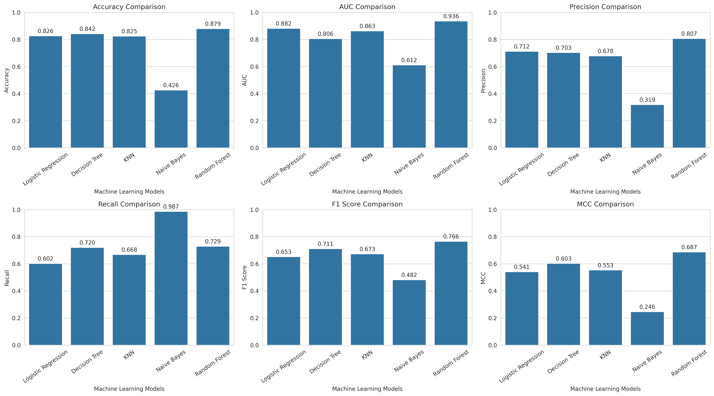

# Hotel Booking Cancellation Prediction

## 1. Problem Statement

Hotel booking cancellations create challenges for hotel management because they affect room availability, revenue planning, and resource allocation.

The objective of this project is to develop and compare machine learning classification models to predict whether a hotel booking will be canceled or not.

The target variable is `is_canceled`:

- `0` – Booking not canceled
- `1` – Booking canceled

Five classification algorithms are implemented and evaluated to identify the best-performing model.

## 2. Dataset Description

**Dataset:** Hotel Booking Demand

**Source:** [Kaggle – Hotel Booking Demand](https://www.kaggle.com/datasets/jessemostipak/hotel-booking-demand)

- Original records: 119,390
- Original columns: 32
- Target variable: `is_canceled`
- Data type: Numerical and categorical

### Data Cleaning

- Identified missing values in the dataset.
- Removed 31,994 duplicate records.
- Removed columns with excessive missing values or potential target leakage.
- Handled missing numerical values using median imputation.
- Handled missing categorical values using most-frequent imputation.
- Applied standard scaling to numerical features.
- Applied one-hot encoding to categorical features.

After duplicate removal, the dataset contained 87,396 records.

 ### Train-Test Split

The cleaned dataset was divided into:

- Training data: 80% (69,916 records)
- Testing data: 20% (17,480 records)

Stratified sampling was used to maintain the class distribution. A fixed random state of 42 was used for reproducibility.

Preprocessing transformations were fitted using only the training data.

## 3. GitHub Repository

**Repository Link:** [Hotel Booking Cancellation Prediction](https://github.com/HarshitaTirupathi/Hotel_Booking_Cancellation_Prediction)

## 4. Machine Learning Algorithms

The following five classification algorithms were implemented:

1. Logistic Regression
2. Decision Tree
3. K-Nearest Neighbors (KNN)
4. Gaussian Naive Bayes
5. Random Forest

###  Model Performance Comparison

The models were evaluated using Accuracy, AUC, Precision, Recall, F1 Score, and Matthews Correlation Coefficient (MCC).

| Model | Accuracy | AUC | Precision | Recall | F1 Score | MCC |
|---|---:|---:|---:|---:|---:|---:|
| Logistic Regression | 0.7901 | 0.8328 | 0.6726 | 0.4606 | 0.5468 | 0.4290 |
| Decision Tree | 0.7960 | 0.7478 | 0.6274 | 0.6350 | 0.6312 | 0.4902 |
| KNN | 0.7905 | 0.8144 | 0.6336 | 0.5640 | 0.5968 | 0.4573 |
| Naive Bayes | 0.3724 | 0.5653 | 0.3032 | 0.9888 | 0.4641 | 0.1868 |
| Random Forest | 0.8437 | 0.9019 | 0.7598 | 0.6308 | 0.6893 | 0.5907 |

## 5. Model Observations

| ML Model Name | Observation about Model Performance |
|---|---|
| Logistic Regression | Achieved 79.01% accuracy and 0.8328 AUC. However, its recall of 46.06% indicates that it missed several actual booking cancellations. |
| Decision Tree | Achieved 79.60% accuracy and 63.50% recall. It provided a reasonable balance between precision and recall. |
| K-Nearest Neighbors (KNN) | Achieved 79.05% accuracy and 0.8144 AUC. It demonstrated reasonable classification performance across the evaluation metrics. |
| Gaussian Naive Bayes | Achieved the highest recall of 98.88%. However, its precision of 30.32% and accuracy of 37.24% indicate a high number of false-positive predictions. |
| Random Forest | Achieved the highest accuracy, AUC, precision, F1 Score, and MCC among all five models. It demonstrated the best overall classification performance. |

## 6. Visualization

The performance of all five classification algorithms was compared through graphical representations of:

- Accuracy
- AUC
- Precision
- Recall
- F1 Score
- MCC

The visualization file is included in this repository.

## 7. Overall Winner

Random Forest was selected as the overall best-performing model.

It achieved:

- Accuracy: 84.37%
- AUC: 0.9019
- Precision: 75.98%
- F1 Score: 0.6893
- MCC: 0.5907

- Recall: 63.08%

Therefore, Random Forest was selected as the overall winner because it achieved the best performance in five out of the six evaluation metrics. Its balanced performance across accuracy, precision, recall, F1 Score, AUC, and MCC makes it the most suitable model among the five evaluated algorithms.

## 8. Repository Contents

- `Hotel_Booking_Cancellation_Prediction.ipynb` – Complete implementation and model evaluation.
- `test_data.csv` – Testing dataset.
- `model_comparison.csv` – Evaluation results.
- `model_comparison_visualization.png` – Performance comparison graphs.
- `requirements.txt` – Required Python libraries.
- `models/` – Saved preprocessing pipeline and trained models.
